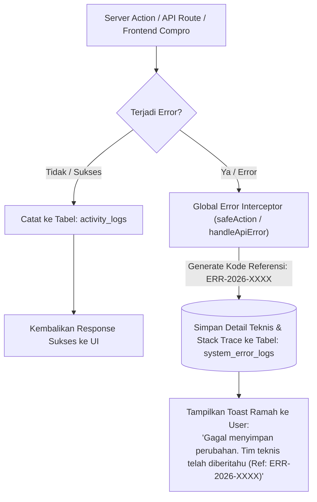

# Dokumen Referensi Arsitektur, Spesifikasi UI/UX & Master Task Plan: `cms-versa-morph`

> [!NOTE]
> Dokumen ini merupakan blueprint teknis & rencana eksekusi (Master Implementation Plan) untuk pembangunan **Custom Admin Dashboard & Headless CMS (`cms-versa-morph`)** yang mengelola seluruh konten, komersial, dan monitoring website **Versa Morph (`compro-versa-morph`)** di **Vercel**.

---

## 1. Spesifikasi Desain UI/UX (Berdasarkan Gambar Referensi)

Mengacu pada gambar referensi UI yang Anda lampirkan, desain `cms-versa-morph` menggunakan pendekatan **Hybrid High-Contrast Bento UI** (tanpa sidebar vertikal kaku di kiri, melainkan menggunakan **Top Pill Dock Navigation** dan **Master-Detail Split Workspace**):

### A. Elemen Kunci Layout & Visual
1. **Top Pill Navigation Bar (Header Utama):**
   * **Kiri:** Logo **Versa Morph** + Quick Switcher (Icon Grid).
   * **Tengah (Primary Dock):** Kapsul putih/terang (`rounded-full`) berisi menu utama kelompok aktif, dengan **Active Pill berwarna Electric Lime (`#84FF00` / `#A3E635`)** dan teks hitam tebal. Di sebelah kanannya terdapat **Icon Pills** bundar gelap (`#1A1D24`) untuk berpindah kelompok modul dengan cepat.
   * **Kanan:** Tombol Notifikasi (dengan titik indikator), Settings, dan Avatar Admin.
2. **Page Header & Primary Action Bar:**
   * Tombol Back bundar (`←`) + Judul Halaman berukuran besar (`text-4xl font-display font-bold text-white`).
   * Di sisi kanan: Tombol Filter/Sort bundar dan tombol CTA utama berbentuk kapsul (`+ Create ...` dengan border tipis & hover lime).
3. **Top Bento KPI & Summary Cards (2 Kolom Asimetris):**
   * **Kartu Kiri (Lebar - 60%):** Background dark charcoal (`#161920`), sudut sangat membulat (`rounded-[28px]`), menampilkan 3 metrik utama dengan angka besar (`text-3xl`), dilengkapi **Segmented Progress Bar berwarna Lime Green** per periode/kategori dan **Avatar Stack** di bawahnya.
   * **Kartu Kanan (40%):** Menampilkan highlight metrik utama + 3 **Mini Vertical Cards** di bagian bawah di mana kartu yang aktif/di-highlight berwarna **Solid Electric Lime (`#84FF00`)** dengan teks hitam.
4. **Horizontal Active Filters Bar:**
   * Badge `Active filters [n]` diikuti deretan **Pill Dropdowns** (`All categories`, `All statuses`), **Date Range Pills** dengan ikon kalender, dan **Search Pill Input** di ujung kanan.
5. **Bottom Split Workspace (Master-Detail dengan Tab Terintegrasi):**
   * **Floating Folder Tabs di Atas Container:** Tab pill (`All Items`, `Draft [3]`, `Published [5]`) di mana tab aktif berwarna **Lime Green (`#84FF00`)** dengan badge angka bulat hitam.
   * **Container Utama Berwarna Terang (`#F8FAFC` / `#FFFFFF`, `rounded-[32px]`):** Memberikan kontras luar biasa terhadap background utama (`#0B0D12`).
   * **Panel Kiri (Master List - 35%):** Daftar item di atas background putih/terang. Item yang sedang dipilih (aktif) berubah menjadi **Kapsul Hitam/Charcoal (`#161920`)** dengan teks putih dan badge status putih.
   * **Panel Kanan (Detail & Quick Editor - 65%):** Inset Card besar berwarna **Dark Charcoal (`#14171E`, `rounded-[24px]`)** di dalam container putih. Menampilkan header detail item, info relasi/author, grid **Bento Sub-Cards** (`+` card dengan arsiran diagonal untuk tambah sub-item), summary footer bar, dan tombol aksi utama berwarna **Electric Lime (`Publish Now` / `Save Changes`)**.

---

## 2. Struktur Menu Navigasi CMS (Berdasarkan Menu Frontend `compro-versa-morph`)

Seluruh menu di [`Navbar.tsx`](file:///e:/Sahri/Versa%20Morph/compro/compro-versa-morph/src/components/Navbar.tsx) dan [`Footer.tsx`](file:///e:/Sahri/Versa%20Morph/compro/compro-versa-morph/src/components/Footer.tsx) pada `compro-versa-morph` dirampingkan ke dalam **Top Pill Navigation Bar** agar bersih dan tidak penuh:

| Grup Navigasi (Top Dock) | Sub-Tab Pill di Dalamnya | Mengelola Menu / Halaman Compro |
| :--- | :--- | :--- |
| **1. Overview** | `Dashboard` | Ringkasan KPI seluruh website, trafik leads, & quick cache sync. |
| **2. Content & Pages** | `Services & Solutions` • `Portfolio` • `Blog` • `FAQ` | Menu **Services** (`/services`), **Solutions** (`/solutions`), **Portfolio** (`/portfolio`), **Blog** (`/blog`), **FAQ** (`/faq`). |
| **3. Commercial** | `Pricing Tiers` • `Project Calculator` • `Partners` | Menu **Pricing** (`/pricing`), **Project Calculator** (`/calculator`), **Partners** (`/partners`). |
| **4. Company & HR** | `About & Team` • `Testimonials` • `Careers` • `Legal Pages` | Menu **About Us** (`/about`), **Team** (`/team`), **Testimonials**, **Careers** (`/careers`), & **9 Halaman Legal** (`/privacy-policy`, `/sla`, `/dpa`, dll.). |
| **5. Inbound & CRM** | `Leads Inbox` • `Affiliates` • `Job Applicants` | Menu **Contact Sales** (`/contact`), **AI Chat Leads**, **Affiliate Loop** (`/affiliate`), & **Lamaran Kerja**. |
| **6. System Monitor** *(Icon Pill)* | `Activity Logs` • `System Error Logs` | **Monitoring Aktivitas Admin** & **Tabel Error Teknis Terpisah** (termasuk error dari frontend compro [`error-logger.ts`](file:///e:/Sahri/Versa%20Morph/compro/compro-versa-morph/src/lib/error-logger.ts)). |

---

## 3. Arsitektur Error Handling & Monitoring (Friendly UI + Tabel Terpisah)

Sesuai permintaan Anda, **tidak boleh ada error teknis (stack trace, error SQL Drizzle, atau raw exception)** yang tampil ke pengguna/admin di UI:



1. **Tabel `system_error_logs` (Khusus Error Teknis):**
   * Menyimpan: `id`, `referenceCode` (`ERR-XXXX`), `source` (`CMS_SERVER_ACTION` | `CMS_API` | `COMPRO_FRONTEND`), `severity` (`WARN` | `ERROR` | `FATAL`), `friendlyMessage`, `technicalMessage`, `stackTrace`, `requestUrl`, `payloadSnapshot` (JSON yang sudah disanitasi dari password/token), `userAgent`, `actorId`, `isResolved`, `resolvedAt`, `createdAt`.
   * Terintegrasi langsung dengan [`src/lib/error-logger.ts`](file:///e:/Sahri/Versa%20Morph/compro/compro-versa-morph/src/lib/error-logger.ts) milik `compro-versa-morph` (endpoint `/api/log-error` akan meneruskan error ke database ini).
2. **Tabel `activity_logs` (Khusus Audit & Monitoring Aktivitas):**
   * Menyimpan: `id`, `actorId`, `actorName`, `actorRole`, `action` (`CREATE` | `UPDATE` | `DELETE` | `PUBLISH` | `LOGIN` | `REVALIDATE` | `STATUS_CHANGE`), `module` (`BLOG`, `PROJECT`, `PRICING`, `LEAD`, dll.), `targetId`, `targetTitle`, `changes` (JSON `{ before, after }`), `ipAddress`, `createdAt`.
3. **Menu Monitoring di CMS (`/monitoring`):**
   * Menggunakan layout Bento Master-Detail seperti gambar referensi: panel kiri berisi daftar log terbaru (dengan filter `Activity` vs `Error Logs`, filter severity `Fatal/Error/Warn`, dan status `Unresolved/Resolved`), sedangkan panel kanan gelap menampilkan rincian payload/diff perubahan atau stack trace teknis bagi developer serta tombol **"Mark as Resolved"**.

---

## 4. Struktur Folder Project (`Feature-Based Architecture`)

```text
cms-versa-morph/
├── drizzle/                        # Migrasi SQL Drizzle
├── src/
│   ├── app/
│   │   ├── (auth)/login/           # Halaman Login Admin bergaya Dark Bento
│   │   ├── (dashboard)/            # Layout dengan Top Pill Navigation Bar (tanpa sidebar kaku)
│   │   │   ├── page.tsx            # Overview Dashboard
│   │   │   ├── content/            # Halaman Services, Solutions, Portfolio, Blog, FAQ
│   │   │   ├── commercial/         # Halaman Pricing Tiers, Calculator Config, Partners
│   │   │   ├── company/            # Halaman About, Team, Testimonials, Careers, Legal
│   │   │   ├── crm/                # Halaman Leads Inbox, Affiliates, Job Applicants
│   │   │   └── monitoring/         # Halaman Activity Logs & System Error Logs
│   │   └── api/
│   │       ├── v1/content/         # Public GET API untuk compro-versa-morph
│   │       ├── v1/inbound/         # POST API untuk Leads, Affiliates, Applicants dari compro
│   │       └── v1/telemetry/       # POST API penerima error dari compro (/api/log-error)
│   │
│   ├── features/                   # MODUL FITUR MANDIRI (Components, Server Actions, Queries, Zod Schema)
│   │   ├── auth/
│   │   ├── dashboard/
│   │   ├── services-solutions/     # Kelola Services, Detail Layanan, Solutions, DSDDO Steps
│   │   ├── portfolio/              # Kelola Projects & Timeline Phases
│   │   ├── blog/                   # Kelola Blog Posts & Tiptap Editor
│   │   ├── faq/                    # Kelola FAQ & Kategori
│   │   ├── pricing-calculator/     # Kelola Pricing Tiers & Rumus/Harga Project Calculator
│   │   ├── partners/               # Kelola Technology Partners
│   │   ├── company-profile/        # Kelola About Stats, Values, Team, Testimonials, Legal Pages
│   │   ├── careers/                # Kelola Job Openings
│   │   ├── crm-inbound/            # Kelola Leads, Affiliates (VM-AFF-XXXXXX), & Job Applicants
│   │   └── monitoring/             # Modul Activity Logs, Error Logs Viewer, & Wrapper safeAction()
│   │
│   ├── components/
│   │   ├── layout/                 # TopPillNavbar.tsx, PageHeaderBar.tsx, FilterPillBar.tsx
│   │   ├── bento/                  # BentoKpiCard.tsx, SplitWorkspace.tsx, MasterListItem.tsx, DetailInsetCard.tsx
│   │   ├── editor/                 # TiptapEditor.tsx, DynamicListInput.tsx, ImageUploader.tsx
│   │   └── ui/                     # Komponen dasar (Toast ramah error, Modal, Pill Badges, Buttons)
│   │
│   ├── db/
│   │   ├── index.ts                # Koneksi Serverless PostgreSQL
│   │   ├── seed.ts                 # Seeder otomatis dari compro-versa-morph/src/data/*
│   │   └── schema/                 # Skema tabel Drizzle per fitur + monitoring.ts (activity_logs & system_error_logs)
│   └── lib/
│       ├── safe-action.ts          # Interceptor Server Action: tangkap error -> simpan ke system_error_logs -> return pesan ramah
│       ├── activity-logger.ts      # Helper pencatat otomatis setiap aksi CRUD ke activity_logs
│       └── revalidate-compro.ts    # Webhook trigger revalidateTag ke compro-versa-morph
```

---

## 5. Master Task Breakdown (Rencana Eksekusi Bertahap)

Berikut adalah daftar **Task** terstruktur yang akan kita kerjakan secara berurutan:

### 🛠️ TASK 1: Inisialisasi Project & Design System "Bento Electric Lime"
* **1.1.** Inisialisasi Next.js 16 (TypeScript, App Router, Tailwind CSS v4) di folder [`cms-versa-morph`](file:///e:/Sahri/Versa%20Morph/compro/cms-versa-morph).
* **1.2.** Konfigurasi palet warna sesuai gambar referensi:
  * Background Utama: `#0B0D12` (Obsidian Dark)
  * Card Gelap / Bento Atas & Inset Detail: `#14171E` & `#1C2029`
  * Split Container Bawah (Master List): `#F8FAFC` / `#FFFFFF`
  * Primary Accent: `#84FF00` / `#A3E635` (Electric Lime) dengan teks `#090A0F`
* **1.3.** Pembuatan komponen layout inti sesuai gambar referensi:
  * `TopPillNavbar`: Kapsul navigasi atas dengan tab aktif hijau lime & grup ikon bundar.
  * `BentoKpiSection`: Kartu metrik atas dengan progress bar lime & mini vertical highlight cards.
  * `FilterPillBar`: Baris filter horizontal berbentuk pill + search input.
  * `SplitWorkspace`: Container putih ber-tab (`All`, `Draft`, `Published`) dengan Master List di kiri dan Dark Inset Detail/Form Card di kanan.

### 🗄️ TASK 2: Database Schema (Drizzle ORM) & Seeding Data Compro
* **2.1.** Setup Drizzle ORM + PostgreSQL schema di `src/db/schema/` untuk seluruh entitas menu compro (`services`, `solutions`, `projects`, `blog_posts`, `faq_items`, `pricing_tiers`, `calculator_configs`, `partners`, `team_members`, `testimonials`, `job_openings`, `site_settings`, `legal_pages`).
* **2.2.** Setup skema tabel CRM Inbound (`leads`, `affiliates`, `affiliate_referrals`, `job_applicants`).
* **2.3.** Setup skema tabel Monitoring terpisah:
  * Tabel `activity_logs` (untuk audit trail semua aktivitas user).
  * Tabel `system_error_logs` (untuk menyimpan error teknis & stack trace secara terpisah).
* **2.4.** Pembuatan script `src/db/seed.ts` untuk memigrasikan seluruh data awal dari [`compro-versa-morph/src/data/`](file:///e:/Sahri/Versa%20Morph/compro/compro-versa-morph/src/data) ke database.

### 🛡️ TASK 3: Sistem Error Handling Ramah Pengguna & Modul Monitoring (`/monitoring`)
* **3.1.** Membuat utility `safeAction()` dan `handleApiError()`:
  * Menangkap semua error runtime/database/validasi.
  * Menyimpan detail teknis & stack trace ke tabel `system_error_logs` beserta kode referensi unik (`ERR-XXXX`).
  * Mengembalikan pesan yang sopan dan non-teknis ke UI Toast/Alert.
* **3.2.** Membuat helper `logActivity()` yang otomatis mencatat siapa mengubah menu apa beserta data *before/after* ke tabel `activity_logs`.
* **3.3.** Membangun halaman **System Monitor (`/monitoring`)** dengan desain Bento Master-Detail:
  * Tab `Activity Logs` (Timeline aktivitas admin, filter per modul & user).
  * Tab `Error Logs` (Daftar insiden error dari CMS maupun Frontend Compro, lengkap dengan detail teknis di panel kanan & tombol *Resolve*).

### 📝 TASK 4: Grup Menu "Content & Pages" (`/content`)
Menggunakan layout Split Workspace (Master List di kiri, Editor di kanan):
* **4.1. Services & Solutions:** CRUD Layanan utama, halaman detail layanan (`benefits`, `process`, `technologies`, `useCases`), daftar Solutions (`/solutions`), dan 6 langkah DSDDO.
* **4.2. Portfolio (`/portfolio`):** CRUD Studi Kasus Proyek (`client`, `industry`, `problem`, `solution`, `result`, `tech[]`, dan `timeline[]` phases).
* **4.3. Blog (`/blog`):** CRUD Artikel Blog dengan Tiptap Rich Text Editor, kategori, waktu baca otomatis, dan status `Draft` / `Published`.
* **4.4. FAQ (`/faq`):** CRUD tanya-jawab per kategori (`General`, `Services`, `Process`, `Technical`, `Support`).

### 💰 TASK 5: Grup Menu "Commercial" (`/commercial`)
* **5.1. Pricing Tiers (`/pricing`):** CRUD paket harga (`Discovery`, `Growth`, `Enterprise`), daftar fitur, dan toggle *Most Popular*.
* **5.2. Project Calculator (`/calculator`):** Editor visual untuk mengubah *Base Cost*, *Base Weeks*, *Scale Multipliers* (`MVP`, `Growing`, `Enterprise`), dan harga *Add-ons* (`AI Agent`, `Payment Gateway`, dll.) pada kalkulator proyek.
* **5.3. Technology Partners (`/partners`):** CRUD mitra teknologi beserta kategori, warna brand, dan logo.

### 🏢 TASK 6: Grup Menu "Company & HR" (`/company`)
* **6.1. About & Team (`/about` & `/team`):** Edit informasi kontak perusahaan, statistik (`150+`, `24/7`, `99.9%`), nilai perusahaan, serta CRUD profil pimpinan/tim.
* **6.2. Testimonials:** CRUD kutipan testimoni klien & proyek terkait.
* **6.3. Careers (`/careers`):** CRUD lowongan kerja aktif/nonaktif (`Full-time`, `Contract`, `Remote`, `Hybrid`, `requirements[]`).
* **6.4. Legal Pages:** Editor konten untuk 9 halaman legal (`Privacy Policy`, `Terms`, `Cookie Policy`, `SLA`, `DPA`, `NDA`, `Affiliate Agreement`, `Partnership Guidelines`, `Applicant Privacy`).

### 📥 TASK 7: Grup Menu "Inbound & CRM" (`/crm`)
* **7.1. Leads Inbox (`/contact` & AI Chatbot):** Tampilan Master-Detail ala gambar referensi (`All Leads`, `New`, `In Progress`, `Won`). Panel kiri menampilkan daftar pengirim & nilai estimasi budget; panel kanan menampilkan profil perusahaan, pesan brief, dan sub-card catatan follow-up sales.
* **7.2. Affiliates (`/affiliate`):** Daftar partner affiliate (`VM-AFF-XXXXXX`) beserta daftar proyek klien yang mereka referensikan.
* **7.3. Job Applicants:** Daftar pelamar kerja yang masuk dari halaman `/careers`, filter per posisi lowongan, status rekrutmen, dan tombol lihat CV.

### 🔗 TASK 8: Integrasi API, Telemetry Error & On-Demand Revalidation ke `compro-versa-morph`
* **8.1.** Menyediakan endpoint `/api/v1/content` dan webhook `/api/revalidate` agar setiap perubahan di CMS langsung meng-update [`compro-versa-morph`](file:///e:/Sahri/Versa%20Morph/compro/compro-versa-morph) di Vercel secara instan.
* **8.2.** Menghubungkan form [`/api/leads`](file:///e:/Sahri/Versa%20Morph/compro/compro-versa-morph/src/app/api/leads/route.ts) dan [`error-logger.ts`](file:///e:/Sahri/Versa%20Morph/compro/compro-versa-morph/src/lib/error-logger.ts) di `compro-versa-morph` agar langsung menyimpan data leads, affiliate, lamaran, serta error frontend ke database CMS.
